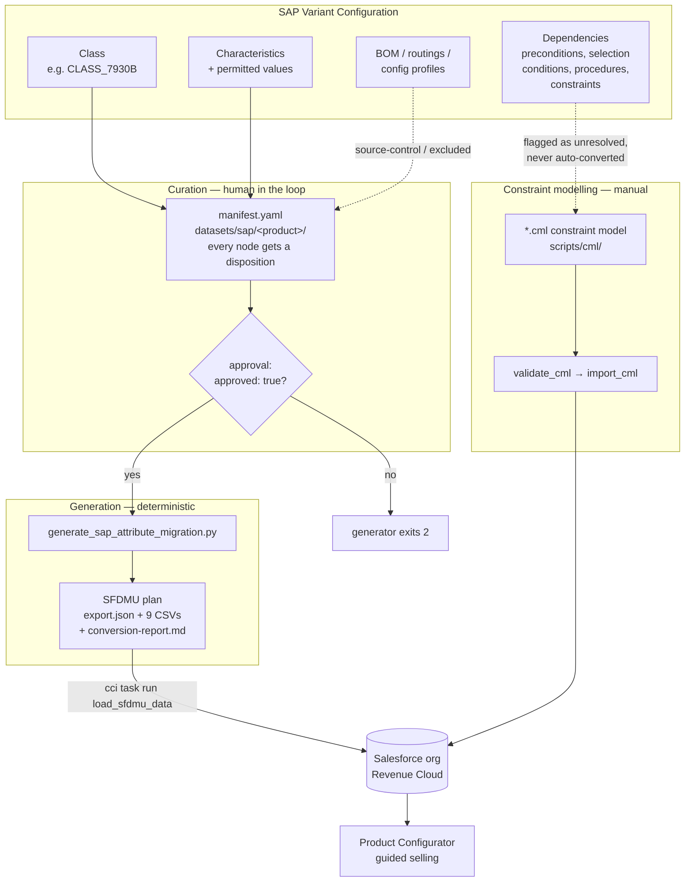
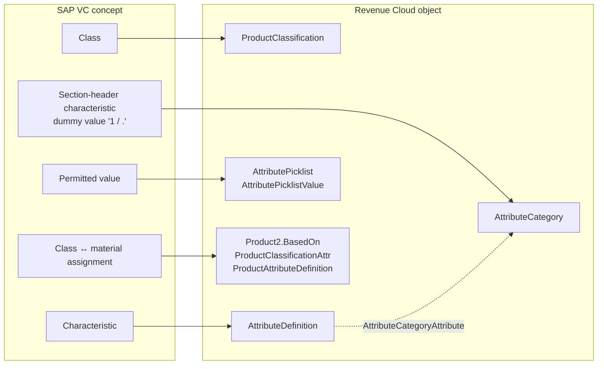
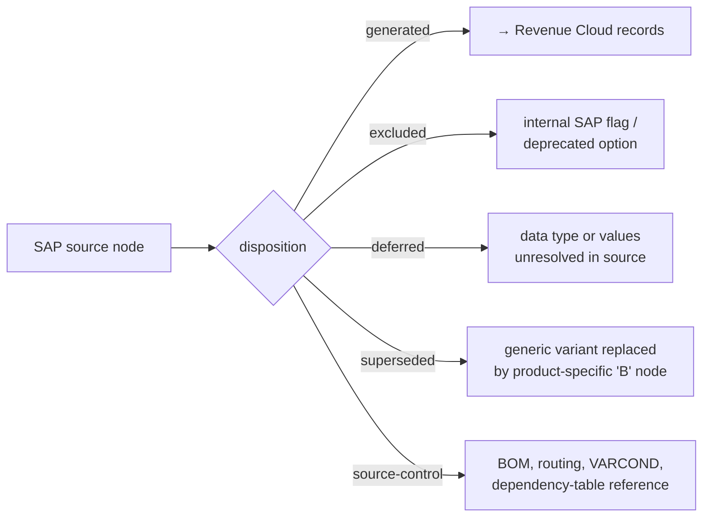
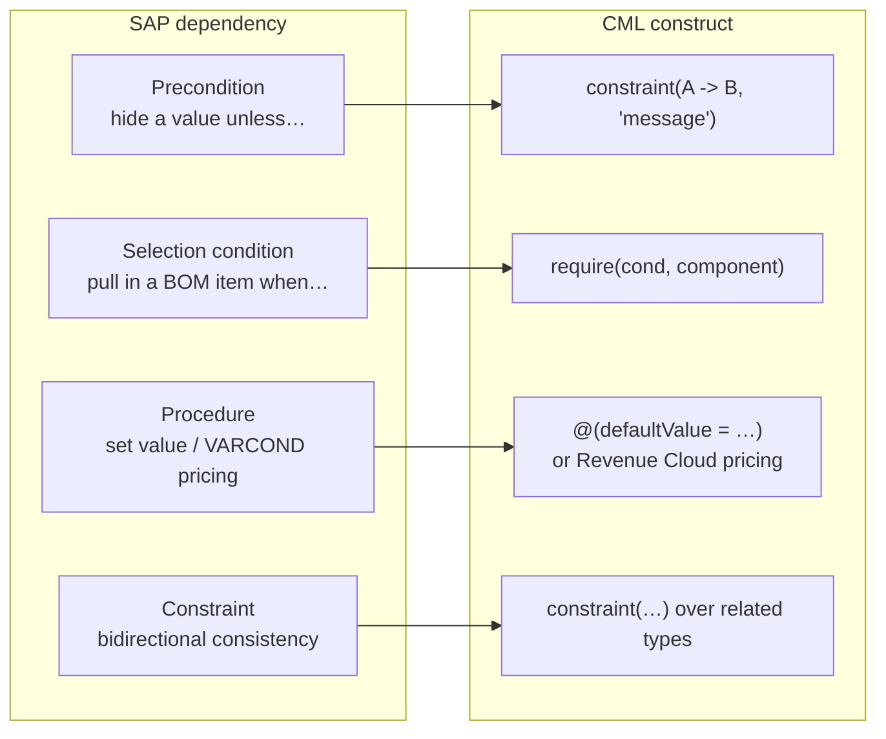
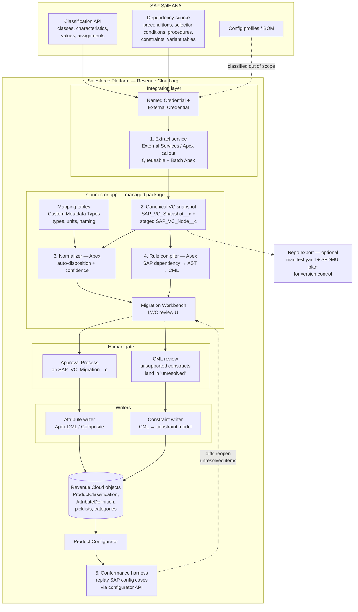
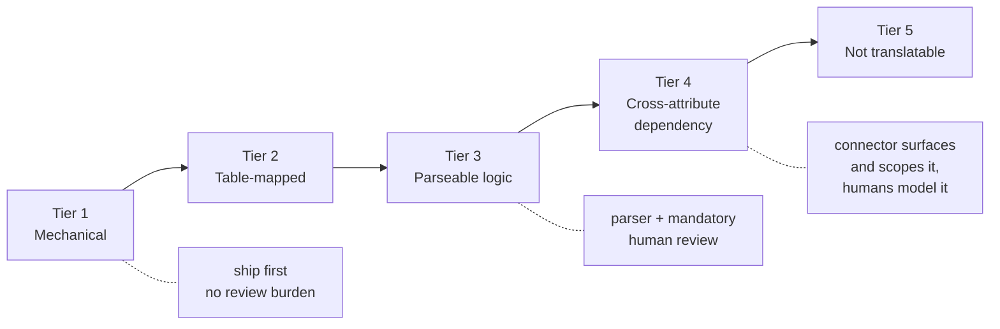

# SAP Variant Configuration → Revenue Cloud Translation

High-level view of how SAP VC **characteristics** become Revenue Cloud
**attributes**, and how SAP VC **dependencies** become **CML** constraints.

The two halves are deliberately separate. The characteristic half is
generated and deterministic. The dependency half is authored by a human
and is **not** derived automatically from the SAP source.

---

## 1. End-to-end pipeline



---

## 2. Object mapping — characteristics → attributes



| SAP VC | Revenue Cloud | Notes |
|---|---|---|
| Class | `ProductClassification` | `Code` = `SAP-<class>`; one per migrated class |
| Section-header characteristic | `AttributeCategory` | Recognised by the dummy `1 / .` value |
| Characteristic | `AttributeDefinition` | `SourceSystemIdentifier` keeps the raw SAP id |
| Permitted values | `AttributePicklist` + `AttributePicklistValue` | Identical value sets are de-duplicated into one shared picklist; `Abbreviation` holds the raw SAP code |
| Single permitted value | attribute flagged `IsRequired` + `IsReadOnly` + `DefaultValue` | A forced value is configuration, not a choice |
| Class assignment | `Product2.BasedOn`, `ProductClassificationAttr`, `ProductAttributeDefinition` | `Product2` is **Update** only — the generator never creates products |
| Characteristic grouping | `AttributeCategoryAttribute` | Composite key, loaded via traversal |

Identity rule: raw SAP codes (`A`, `X`, `1`) are never used as record
identities. Every generated code is source-qualified as
`SAP-<class>-<characteristic>[-<value>]`.

---

## 3. Disposition gate — nothing disappears silently

Every SAP node in the source document is accounted for in the manifest:



Only `generated` produces records. The other four are carried forward in
`conversion-report.md` for traceability and review.

---

## 4. Rules → CML

SAP expresses product logic in four dependency types. CML expresses the
same intent with a different vocabulary:



| SAP dependency | CML / Revenue Cloud equivalent |
|---|---|
| Precondition | `constraint(X == "a" -> Y == "b", "message")` restricting allowed combinations |
| Selection condition | `require(<condition>, <relation>)` pulling a child line item into the configuration |
| Procedure — value assignment | `@(defaultValue = "…")` annotation or a derivation constraint |
| Procedure — `VARCOND` / `VARCONDMM` | **Not CML.** Variant pricing maps to Revenue Cloud attribute-based pricing, not the constraints engine |
| Constraint (object dependency net) | `constraint(...)` across related CML types |
| BOM / routing / config profile | Out of scope — manufacturing structure, not a selling choice |

### Current state in this repo

The Servomex source PDF flags dependency logic through the `Dep.` column
and icons but **does not contain the rule bodies**. That gap is recorded
in the manifest:

```yaml
unresolved:
  - id: CLASS_7930B-dependencies
    reason: >-
      The source document flags SAP dependency and variant-condition logic
      through the Dep. column and icons, but does not contain the rules
      themselves. No Revenue Cloud constraints were generated, and no
      generated option combination is proven valid.
```

Consequence: the generated attributes render a complete selling surface,
but **no option combination is validated** until the CML model is
authored against the real SAP dependency source.

---

## 5. Why the two tracks stay separate

| | Attributes track | CML track |
|---|---|---|
| Source | SAP characteristic list | SAP dependency / constraint source |
| Authoring | Generated from approved manifest | Hand-authored `.cml` |
| Determinism | Byte-identical for a given manifest | Reviewed like code |
| Load path | SFDMU plan → `load_sfdmu_data` | `validate_cml` → `import_cml` |
| Rebuild | Edit manifest, re-run generator | Edit `.cml`, re-validate, re-import |

Attributes must exist in the org **before** a CML model can reference
them, so the attributes track always runs first.

---

## 6. Proposal — automating this with a connector

Today the extract and curate steps are manual because the input is a PDF.
If the connector reads SAP directly instead, most of the pipeline becomes
machine-driven. The piece that stays human is rule modelling — and the
proposal below is built around admitting that rather than hiding it.

The connector is proposed as a **Salesforce-platform application** —
a 2GP package installed in the Revenue Cloud org — rather than an
external ETL job. The target objects, the configurator it must be
verified against, and the admins who own the mapping decisions all
already live in the org; moving the pipeline to where its data and its
reviewers are removes a deployment hop and lets the human gate be a
native approval process instead of a pull request.

### 6.1 Target architecture



Platform building blocks, and why each one:

| Concern | Platform component |
|---|---|
| SAP authentication | Named Credential + External Credential — no secrets in Apex |
| Extraction | External Services over the SAP OData APIs, or Apex `HttpCallout` where no OpenAPI description exists; Queueable chains for paging, Batch Apex for volume |
| Snapshot storage | `SAP_VC_Snapshot__c` header with the raw payload as a `ContentVersion`, staged into `SAP_VC_Node__c` rows |
| Mapping policy | Custom Metadata Types — type, unit, and naming maps are configuration, deployable and diffable, editable without code |
| Curation UI | LWC Migration Workbench — disposition picklists, confidence scores, source text side by side |
| Approval | Native Approval Process on `SAP_VC_Migration__c`; nothing writes to Revenue Cloud before approval |
| Writing records | Apex DML / Composite API straight into the target objects — SFDMU is no longer in the runtime path |
| Scheduling / re-sync | Scheduled Flow or Apex Scheduler triggering a delta extract |
| Distribution | 2GP managed or unlocked package, so the same connector installs into every customer org |

Three design choices carry the proposal:

1. **The connector moves the pipeline into the org, not the governance
   out of it.** Dispositions, the approval gate, and the conversion
   report all survive — they become records and an approval process
   instead of YAML and a pull request. The connector changes who drafts
   the migration, not who signs it.
2. **The rule compiler refuses rather than guesses.** Any SAP construct
   it cannot translate with certainty is written as an `unresolved`
   record. A silently wrong constraint is far more expensive than a
   missing one.
3. **The repo path stays available as an export.** The snapshot can still
   emit `manifest.yaml` and an SFDMU plan for teams that want the
   migration under source control, or for scratch-org rebuilds. In-org is
   the runtime; the repo is the audit trail.

### 6.2 Complexity ranking

| Tier | Conversion | Automation | Why |
|---|---|---|---|
| **1 — Mechanical** | Class → `ProductClassification`; characteristic → `AttributeDefinition`; permitted values → picklists; class assignment → `ProductClassificationAttr` / `ProductAttributeDefinition`; section header → `AttributeCategory` | ~100% | Pure structural restatement. Both sides are flat metadata with a 1:1 shape. Already proven by the current generator. |
| **2 — Table-mapped** | SAP data types and formats → Revenue Cloud attribute types; units of measure; multi-value characteristics → multi-select; language-dependent texts → translations; single permitted value → required + read-only + default | ~90% | Deterministic once a mapping table and a unit policy are agreed. The residue is judgement about types SAP has and Revenue Cloud does not — notably **numeric intervals**, which have no native equivalent and must become banded picklists or a documented deferral. |
| **3 — Parseable logic** | Simple preconditions and selection conditions of the form `$SELF.CHAR = 'VALUE'` or boolean combinations thereof; value-assignment procedures → defaults; variant tables → enumerated CML constraints | ~60–70%, always reviewed | The grammar is small and parseable into an AST, then emitted as `constraint(...)` / `require(...)`. Volume-heavy but tractable. Variant tables are mechanical yet can explode into thousands of rows, so the emitter needs a size threshold beyond which it proposes a decision table instead. |
| **4 — Cross-attribute dependency** | Constraint nets with bidirectional inference; procedures with ordering semantics; selection conditions that drive BOM structure → bundle/component design; `$PARENT` / `$ROOT` / `$SUM` scope references in multi-level configurations | ~20–30%, human-led | **This is the hard tier.** SAP constraint nets infer in any direction and depend on processing sequence; CML constraints are declarative over a typed model. Translation is a *remodelling* exercise, not a syntax conversion. BOM-driven selection also forces a product-structure decision — what becomes a bundle, an option, or an attribute — that no parser can make. |
| **5 — Not translatable** | Variant functions calling ABAP; custom user exits; `VARCOND` pricing procedures; BOM explosion, routings, config profiles | 0% | No conceptual equivalent. `VARCOND` is redirected to Revenue Cloud attribute-based pricing as a separate workstream; the rest is manufacturing structure and leaves the selling model entirely. |



The practical read: **roughly 80% of the record volume sits in tiers 1–2
and roughly 80% of the effort sits in tier 4.** A connector that only
automates tiers 1–3 still removes most of the manual labour, provided it
is honest about the tier-4 backlog it leaves behind.

### 6.3 Delivery order

| Phase | Scope | Outcome |
|---|---|---|
| 1 | Named Credential + extract service + canonical snapshot objects | Replaces PDF scraping; snapshots are diffable records, so re-extraction shows what changed in SAP |
| 2 | Normalizer, mapping Custom Metadata, Workbench LWC, approval process, attribute writer | Tiers 1–2 automated end to end inside the org; reviewers triage dispositions rather than author them |
| 3 | Rule compiler for the tier-3 grammar + constraint writer | Simple preconditions and selection conditions emitted as reviewed CML |
| 4 | Conformance harness | Replay known-valid and known-invalid SAP configurations against the Revenue Cloud configurator and diff; this is the only credible proof that tier-4 modelling is correct |
| 5 | Scheduled delta re-sync + repo export | Snapshot diff drives incremental updates; optional `manifest.yaml` / SFDMU export keeps an auditable trail |

### 6.4 Risks to design against

- **Dependency source access.** Standard SAP classification APIs expose
  classes, characteristics, and values cleanly. Dependency source code is
  materially harder to reach and may require RFC or extraction tooling.
  Validate this before committing to tiers 3–4.
- **Silent semantic drift.** A constraint that compiles but means
  something subtly different is the worst failure mode. The conformance
  harness, not the compiler, is the control for this.
- **Identity stability across re-syncs.** Source-qualified codes must stay
  stable when SAP renames a characteristic, otherwise re-sync orphans
  records. Key on the SAP id, carry the label as data.
- **Scope creep into pricing.** `VARCOND` will tempt the connector into
  pricing. Keep it a separate track with its own mapping.
- **Platform limits.** Running in-org means callout timeouts, heap, and
  DML governor limits apply to classes with thousands of characteristics
  and large variant tables. Chunk extraction through Queueable chains and
  writes through Batch Apex from the start rather than retrofitting.
- **Package-boundary access.** The writers touch standard Revenue Cloud
  objects, so the package needs the right permission sets and the
  Revenue Cloud licences present in every target org.

---

## References

- `.cursor/skills/sap-attribute-migration/SKILL.md` — curation and generation rules
- [datasets/sap/servomex-07930b1/manifest.yaml](../../datasets/sap/servomex-07930b1/manifest.yaml) — approved source manifest
- [scripts/ai/generate_sap_attribute_migration.py](../../scripts/ai/generate_sap_attribute_migration.py) — generator
- [docs/guides/constraints-setup.md](../guides/constraints-setup.md) — CML / constraints engine setup
